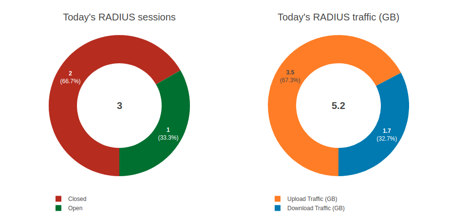
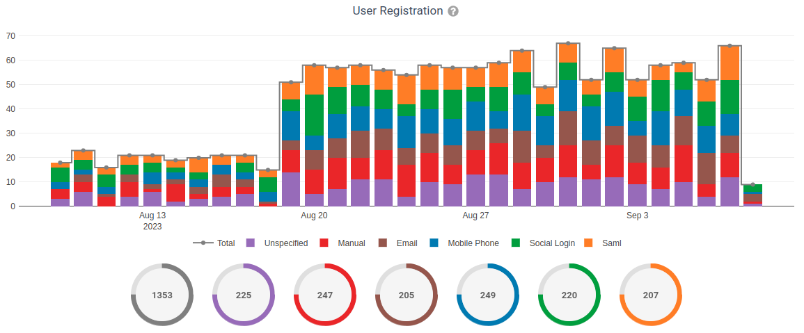
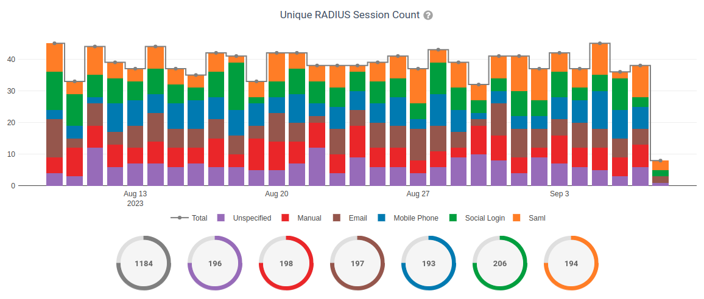

.. _integration_with_openwisp_monitoring:

Integration with OpenWISP Monitoring
====================================

OpenWISP RADIUS includes an optional Django sub-app that adds integration
with :doc:`OpenWISP Monitoring </monitoring/index>` to provide RADIUS
metrics.

RADIUS metrics
--------------

1. User registrations
~~~~~~~~~~~~~~~~~~~~~

This chart shows number of users signed up using different registration
methods.

2. Total user registrations
~~~~~~~~~~~~~~~~~~~~~~~~~~~

.. image:: ../images/total-user-registration-chart.png
    :alt: Total user registration chart

This chart shows total users registered using different registration
methods in the system on a given date.

3. Unique RADIUS Sessions
~~~~~~~~~~~~~~~~~~~~~~~~~

This chart shows unique RADIUS sessions. It is helpful to know how many
unique users has used the system in a given time.

4. RADIUS traffic
~~~~~~~~~~~~~~~~~

.. image:: ../images/radius-traffic-chart.png
    :alt: RADIUS traffic chart

This chart shows hourly observations of traffic from open and closed
sessions. If an observation is missed, the next successful observation
reports the accumulated traffic. It does not redistribute traffic across
the hours in which it occurred.

Enabling RADIUS metrics in Django project
-----------------------------------------

.. include:: /partials/settings-note.rst

You can enable the monitoring integration by including
``openwisp_radius.integrations.monitoring`` in ``INSTALLED_APPS`` of your
Django project's settings as following:

.. code-block:: python

    # In your_project/settings.py

    INSTALLED_APPS.append("openwisp_radius.integrations.monitoring")
    CELERY_BEAT_SCHEDULE.update(
        {
            "write_user_registration_metrics": {
                "task": "openwisp_radius.integrations.monitoring.tasks.write_user_registration_metrics",
                "schedule": timedelta(hours=1),
                "args": None,
                "relative": True,
            },
            "reconcile_radius_traffic": {
                "task": "openwisp_radius.integrations.monitoring.tasks.reconcile_radius_traffic",
                "schedule": timedelta(hours=1),
            },
        }
    )

.. note::

    Ensure your Django project is correctly configured to utilize OpenWISP
    Monitoring. For production environments, it is advisable to deploy
    OpenWISP using :doc:`Ansible OpenWISP </ansible/index>` or
    :doc:`Docker OpenWISP </docker/index>`, as they simplify the
    deployment process considerably.

.. important::

    If you are registering a :ref:`"registration method"
    <openwisp_radius_register_registration_method>` in any other Django
    application, then ``openwisp_radius.integrations.monitoring`` should
    come after that app in the ``INSTALLED_APPS``. Otherwise, the
    registration method would not appear in the chart.

Switching an existing deployment
--------------------------------

Do not enable the hourly schedule while old workers still write
full-session traffic. Use a shared Django cache, accessible to all workers
and management commands, with support for atomic ``cache.add()``. A
process-local cache is not suitable for production.

Perform this maintenance sequence:

1. Prevent new sessions and pause scheduled accounting cleanup.
2. Disconnect all active RADIUS sessions manually using CoA/Disconnect.
   Wait for final accounting updates and confirm no sessions remain open.
3. Drain the old closure-traffic tasks before replacing the workers.
4. With the new code available to management commands, run ``manage.py
   seed_radius_traffic``. This writes zero-traffic checkpoints for
   retained accounting totals. It must succeed before continuing.
5. Restart every worker with the new code. Closure points now contain zero
   traffic but retain the user information needed by unique-user charts.
6. Enable the hourly schedule, resume cleanup, and allow new sessions.

For an empty installation, seed before accepting sessions. The first
reconciliation also seeds automatically when no checkpoints exist. Seeding
an already initialized deployment is rejected to avoid discarding traffic
that has not yet been observed. Seeding and cleanup share the same lock;
retry a skipped or rejected operation after the other has finished.

Cleanup and recovery
--------------------

The ``delete_old_radacct`` command and its Celery wrapper use
``OPENWISP_RADIUS_ACCOUNTING_RETENTION_DAYS`` by default. Move explicit
retention arguments from scheduled cleanup jobs into this setting and
remove the job arguments. Before reducing retention, run ``manage.py check
--database default`` against the deployment database. Resolve warnings
about saved group ``Session-Timeout`` values first. ``None`` disables
automatic retention and its default authorization timeout. Shorter group
and usage-counter timeouts still apply.

Deleting historical sessions subtracts their final counters from the saved
baseline, rather than resetting the baseline to the remaining total. For
example, a baseline of 100 GB, 15 GB of new traffic and deletion of 20 GB
of history leave an 80 GB baseline and 95 GB of retained counters. The
next observation still reports the full 15 GB. A negative adjusted
baseline is valid when deleted rows contain traffic not observed yet.

Cleanup aggregates and deletes all eligible sessions in one transaction,
then updates the baseline after commit. Before deletion, it saves the
prepared adjustment and one selected session ID in the shared cache. If
the commit callback fails or does not run, the next reconciliation or
cleanup checks whether that session still exists. If it does, deletion did
not commit and the adjustment is discarded. Otherwise, the adjustment is
replayed before further collection or cleanup.

This assumes sessions older than retention no longer receive accounting
updates, so it does not explicitly lock rows before aggregation. An update
between aggregation and deletion can make the baseline adjustment
inaccurate. Cleanup also submits a zero-traffic checkpoint for cache
recovery. Run this command outside another database transaction so the
shared coordination lock covers both commit and its callback. Before
baseline initialization, cleanup does not create baselines.

Baselines are keyed by accounting organization and normalized stored
Called-Station-ID, independently of device registration and location. Only
existing devices receive device charts. Unmatched identifiers still
contribute to general traffic. Each new observation uses the device's
current location; historical traffic is not moved. A cache miss recovers
aggregate checkpoints through Monitoring, excluding session-closure
points. Recovery reads checkpoint history, so its cost grows with TSDB
retention. A failed SQL or TSDB read defers collection instead of silently
seeding a replacement baseline.

Operational limits
------------------

Monitoring's metric API queues writes and uses its existing delivery and
retry behavior. Successful submission does not confirm TSDB persistence.
Locally invalid payloads are rejected before submission. An uncertain
submission is retried with its original timestamp, not as a new
observation. Do not interpret this as an exactly-once delivery guarantee.

Cache loss before a queued checkpoint persists can restore stale totals.
Losing the pending cleanup record before its adjusted checkpoint persists
can also prevent recovery of a committed deletion. The cache must report
write failures rather than silently ignore them. SQL, cache and TSDB
changes are not atomic. Shared cache locks prevent ordinary overlap, not
crash recovery; their lease is six hours, so operations must complete
within that time.

Each hourly SQL observation aggregates all retained accounting rows,
including stopped sessions. Use full-width Octets/Gigawords counters from
FreeRADIUS. Quota renewal does not reset these cumulative counters. A
decrease is logged separately for each direction and never produces
negative chart traffic. An individual reset hidden by growth in another
session cannot be detected by aggregate reconciliation.

Retention-derived timeouts depend on NAS enforcement. They do not limit
existing sessions retroactively or prevent delayed accounting updates from
reopening a row. Custom deletion paths and raw SQL maintenance do not
adjust baselines. Converting Called-Station-ID or moving retained counters
between groups can temporarily duplicate reported traffic; baseline
transfers are not supported.

For legacy historical repairs, ``rebuild_radius_accounting_metrics
--commit`` requires ``--end`` before hourly initialization. Never repair
the hourly reporting period. The command rejects ranges reaching an
available aggregate checkpoint and its session-specific deletion filters
do not match aggregate points. Preserve the original cutover time when
TSDB retention removes old checkpoints.
