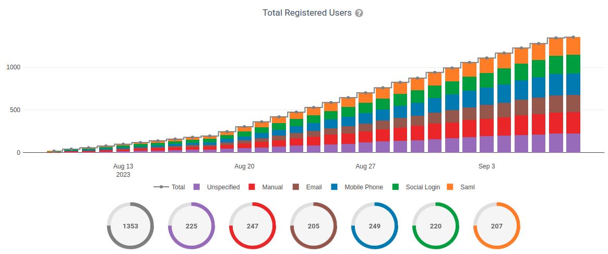
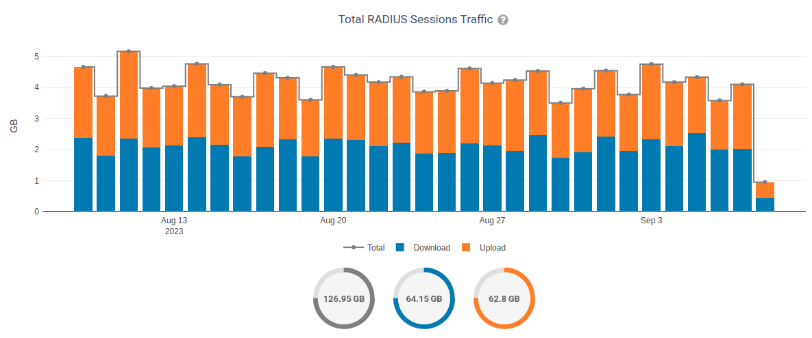

.. _integration_with_openwisp_monitoring:

Integration with OpenWISP Monitoring
====================================

OpenWISP RADIUS includes an optional Django sub-app that adds integration
with :doc:`OpenWISP Monitoring </monitoring/index>` to provide RADIUS
metrics.

.. image:: ../images/radius-dashboard-charts.png
    :alt: RADIUS session dashboard charts

RADIUS metrics
--------------

1. User registrations
~~~~~~~~~~~~~~~~~~~~~

.. image:: ../images/user-registration-chart.png
    :alt: User registration chart

This chart shows number of users signed up using different registration
methods.

2. Total user registrations
~~~~~~~~~~~~~~~~~~~~~~~~~~~

This chart shows total users registered using different registration
methods in the system on a given date.

3. Unique RADIUS Sessions
~~~~~~~~~~~~~~~~~~~~~~~~~

.. image:: ../images/unique-radius-session-chart.png
    :alt: Unique RADIUS session chart

This chart shows unique RADIUS sessions. It is helpful to know how many
unique users has used the system in a given time.

4. RADIUS traffic
~~~~~~~~~~~~~~~~~

This chart shows traffic from active and closed sessions. If a collection
is missed, the next successful collection shows the accumulated traffic at
that time, rather than in the periods when it occurred.

Enabling RADIUS metrics in Django project
-----------------------------------------

.. include:: /partials/settings-note.rst

You can enable the monitoring integration by including
``openwisp_radius.integrations.monitoring`` in ``INSTALLED_APPS`` of your
Django project's settings as following:

.. code-block:: python

    # In your_project/settings.py

    INSTALLED_APPS.append("openwisp_radius.integrations.monitoring")
    CELERY_BEAT_SCHEDULE.update(
        {
            "write_user_registration_metrics": {
                "task": "openwisp_radius.integrations.monitoring.tasks.write_user_registration_metrics",
                "schedule": timedelta(hours=1),
                "args": None,
                "relative": True,
            },
        }
    )

.. note::

    Ensure your Django project is correctly configured to utilize OpenWISP
    Monitoring. For production environments, it is advisable to deploy
    OpenWISP using :doc:`Ansible OpenWISP </ansible/index>` or
    :doc:`Docker OpenWISP </docker/index>`, as they simplify the
    deployment process considerably.

.. important::

    If you are registering a :ref:`"registration method"
    <openwisp_radius_register_registration_method>` in any other Django
    application, then ``openwisp_radius.integrations.monitoring`` should
    come after that app in the ``INSTALLED_APPS``. Otherwise, the
    registration method would not appear in the chart.

The scheduled task collects both registrations and traffic at the
configured interval.

Use a shared Django cache accessible to every worker and management
command. A process-local cache is not suitable for production.

Upgrading an existing Monitoring deployment
-------------------------------------------

The ``0002_initialize_traffic`` migration automatically reports the
current traffic of open sessions and initializes aggregate baselines for
open and closed sessions. The old collector already reported closed
sessions. Do not run a separate baseline-seeding command.

Use a maintenance window for the cutover:

1. Pause accounting updates, scheduled metric collection, accounting
   cleanup, and station-ID conversion. Let the legacy workers finish
   queued session-closure writes, then stop those workers.
2. Back up the accounting database, cache, and time-series data. Record
   the current UTC timestamp immediately before running migrations and
   retain it as the historical-repair cutoff.
3. Deploy the new code and run ``./manage.py migrate`` with the shared
   cache and Monitoring services available. Check the migration logs for
   its snapshot time and submitted input and output octets.
4. Start workers using the new code, resume accounting updates, and enable
   the existing ``write_user_registration_metrics`` schedule. Confirm that
   the next collection reports only traffic accumulated after the
   snapshot.

The migration is irreversible: SQL rollback cannot undo submitted metric
writes. A failed migration may already have submitted some points. Check
its logs and the stored points before retrying; taking a fresh snapshot
can count the same traffic again. Submission alone does not confirm that
points have reached the time-series database.

Historical repairs with ``rebuild_radius_accounting_metrics --commit``
must use an ``--end`` earlier than the recorded cutoff. Keep that cutoff
even after old checkpoints expire; the command cannot reconstruct the
original cutover time from the remaining points.
